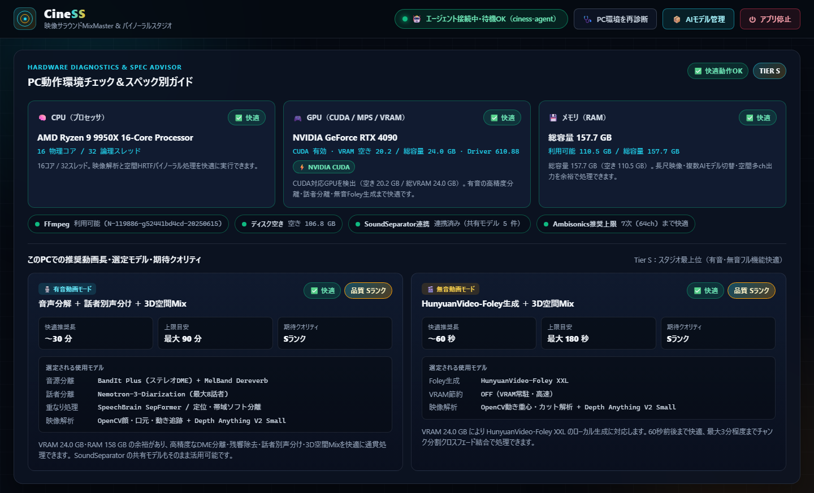
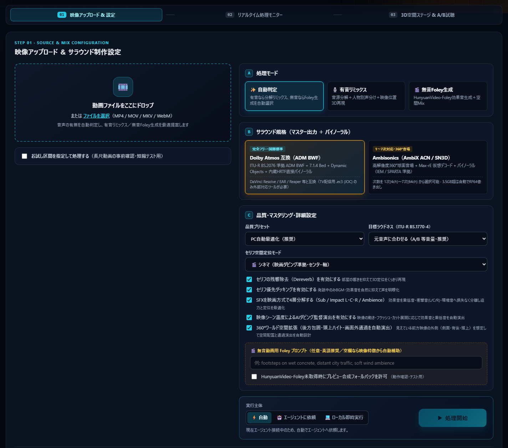
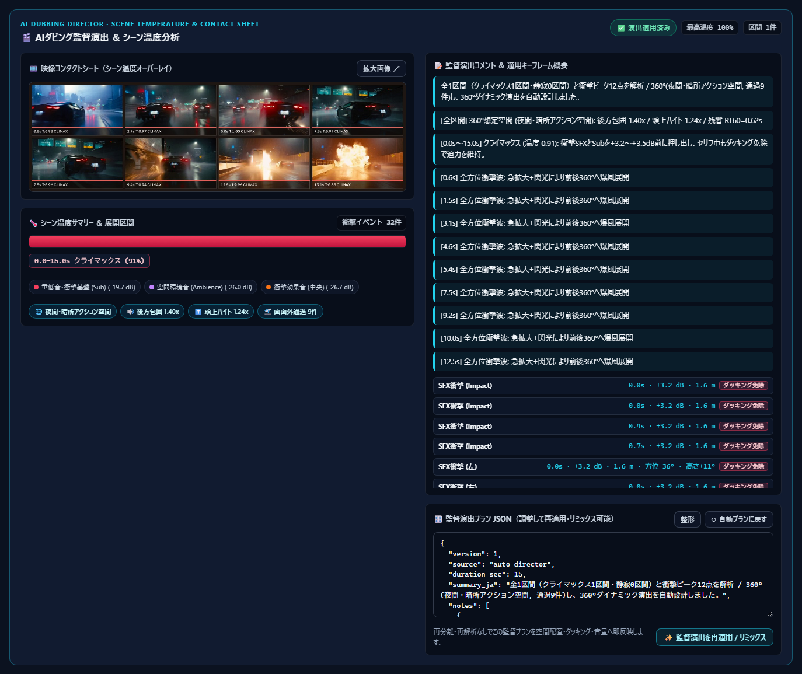
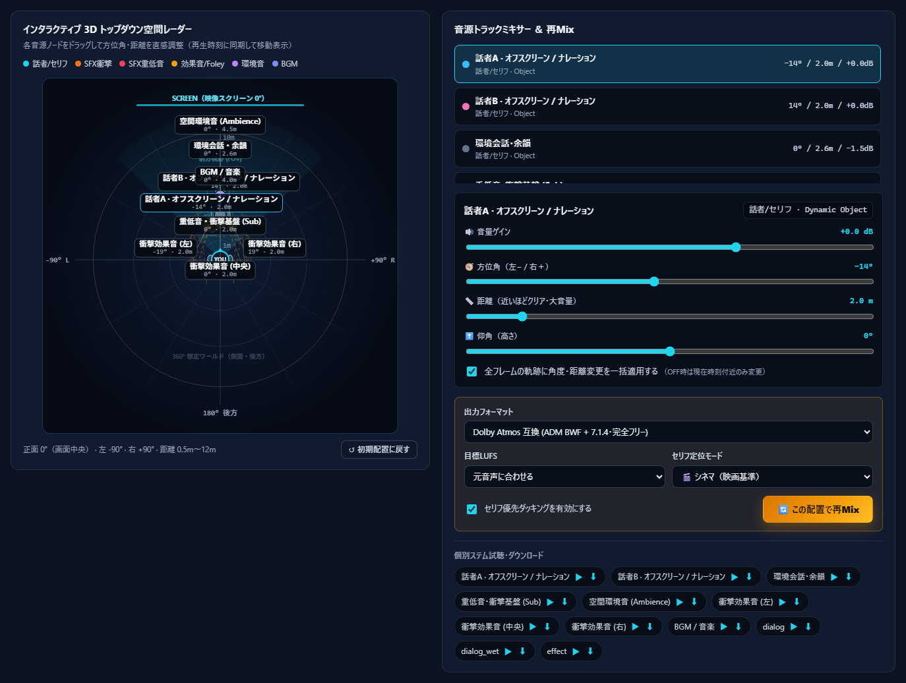

# CineSS — 映像サラウンド MixMaster ＆ バイノーラル出力スタジオ

**CineSS** は、手元の **Windows / macOS (Apple Silicon MPS・Intel) / Linux** PC 上で映像の音声を立体音響（**Dolby Atmos 互換 ADM BWF [完全フリー構成]** / **Ambisonics 1〜7次 AmbiX**）へ再構築し、**ヘッドホンで映画館のような3D定位を体感できるバイノーラル映像（MP4）** を出力するローカル Web アプリケーションです。

AI エージェント（Claude Code / Antigravity / MCP 対応クライアント）とのネイティブ連携を備えており、「リポジトリを読ませるだけで環境確認→Web アプリ起動→ブラウザ上の『▶ 処理開始』ボタン押下をトリガーにエージェントが処理開始→シーン温度コンタクトシートを見て監督演出リミックス」という体験を実現します。

---

## アプリ画面

<table>
  <tr>
    <td width="50%" valign="top">
      <strong>1. PC動作環境チェック ＆ スペック別ガイド</strong><br>
      <br>
      <sub>CPU・GPU（CUDA / MPS / VRAM）・RAM・FFmpeg・SoundSeparator 共有状況を自動診断し、Tier S〜C 別の推奨動画長と使用モデルを案内します。</sub>
    </td>
    <td width="50%" valign="top">
      <strong>2. 映像アップロード ＆ 360°空間設定（Step 1）</strong><br>
      <br>
      <sub>処理モード、Dolby Atmos 互換 / Ambisonics（1〜7次）規格、SFX 4層分解、AIダビング監督、360°ワールド空間拡張を設定して実行します。</sub>
    </td>
  </tr>
  <tr>
    <td width="50%" valign="top">
      <strong>3. AIダビング監督演出 ＆ 360°想定空間（Step 3）</strong><br>
      <br>
      <sub>シーン温度コンタクトシートと 360°想定空間（後方包囲・頭上ハイト・画面外通過）を確認し、JSON 編集から数秒で監督演出を再適用できます。</sub>
    </td>
    <td width="50%" valign="top">
      <strong>4. 3Dトップダウン空間レーダー ＆ ミキサー（Step 3）</strong><br>
      <br>
      <sub>全方位（±180°）・距離（0.5〜12m）・仰角（±90°）・ゲインを視覚的に微調整し、再分離なしで再 Mix・個別ステム試聴が可能です。</sub>
    </td>
  </tr>
</table>

---

## 主な機能

1. **PC動作環境チェック ＆ スペック別おすすめガイド（クロスプラットフォーム対応）**
   - 実機の **CPU / GPU（NVIDIA CUDA・Apple Silicon MPS・AMD/Intel 非NVIDIA検出）/ メモリ（ユニファイドメモリ含む）/ FFmpeg / 空きディスク** を自動計測し、**✅ 快適 / ⚠️ 警告 / ✕ 不足** で分かりやすく表示します。
   - PC スペックに応じて **Tier S / A / B / C** を自動判定し、「有音動画リミックス」「無音動画 Foley 生成」それぞれについて **推奨動画長（快適目安・上限目安）・選定モデル・期待クオリティ** を案内します。
   - **Apple Silicon (MPS)**: ユニファイドメモリ 16GB〜（Tier B）/ 24GB〜（Tier A）環境で MPS 実行に対応します（`run.sh` で `PYTORCH_ENABLE_MPS_FALLBACK=1` を自動設定、Foley 生成時は省メモリ・短尺推奨）。
   - **非NVIDIA GPU (AMD / Intel 等)**: PyTorch CUDA / MPS 非対応環境（`non_nvidia_gpu`）を安全に識別し、CPU 軽量モード（ローカル DSP 3分離＋物理 HRTF）へ自動フォールバックします。
   - 隣接フォルダに `SoundSeparator`（または環境変数 `SOUNDSEPARATOR_DIR`）がある場合は、取得済みの分離・話者分離モデルをコピーせず自動共有します。
2. **有音動画リミックス ＋ 映画方式 SFX 4層厳密分解**
   - 映像音声を **話し声（Dialog）/ 効果音（SFX）/ BGM（Music）** へ3分離（BandIt Plus / DBS-TIGER-DnR、単体環境やCPU環境ではローカルDSPフォールバック）。
   - 複数話者の発話を人物別に声分けし、映像の顔・口元モーション活性度と自動紐付けして「画面左の人は左から、右の人は右から、遠くの人は奥行きをもって」定位させます。
   - **映画方式 SFX 4層厳密相補（ロスレス）分解**:
     - `sfx_sub`: 140Hz LPF 低域・重低音基盤（Atmos 7.1.4 LFE / Ambisonics ACN 0 連携、ダッキング免除）
     - `sfx_impact`（Left / Center / Right）: 衝撃帯域成分をステレオパンで配置（無音側チャンネルは自動畳み込み・激しい衝撃時はセリフダッキングを瞬時解除するスマート・インパクト免除に対応）
     - `ambience`: 空間全体に広がる環境音ベッド
3. **映像シーン温度 ＆ 360° ワールド空間モデリング ＆ AIダビング監督演出**
   - 見えている映像を「360° 全方位空間の前方窓」として捉え、画面上部/下部・エッジ密度・カメラ平行移動を差し引いた残差オプティカルフローから **カメラ外 360° 環境（`world_profile`: 屋外オープン／夜間アクション／室内／広間・残響設定）** と **画面外通過（`flyby_events`: 左右側面→後方・頭上・全方位衝撃波）** を自動推定します。
   - **2段オールパス無相関 360° 空間展開**: 7.1.4 の側面・後方 (`Lrs/Rrs`)・頭上ハイト (`Ltf/Rtf/Ltr/Rtr`) および Ambisonics 10方向球面展開でコムフィルタ濁りのない包囲音場を生成し、イマーシブ設定では画面外話者も側面〜後方へ配置できます。
   - 映像の輝度・暖色度・動きエネルギー・急激なフラッシュ変化から **シーン温度**（`静寂` / `通常` / `高揚` / `クライマックス`）を解析し、激しいアクションの近接距離（1.3〜2.2m）と静寂シーンの遠景距離（3.2〜5.2m）を自然に再現します。
   - 代表フレームを最大8コマまとめた **監督用コンタクトシート画像（`director_sheet.jpg`）** と時間変化キーフレーム（`azimuth_deg` `±180°`・`elevation_deg` `±90°`・`distance_m`・`gain_db`・`world_360` 制御）を含む **AIダビング監督プラン（`director_plan`）** を生成し、Web UI・CLI・MCP から再分離なしで高速に監督演出を微調整・再適用できます。
4. **無音動画 Foley 生成（360°環境＋物体ヒント対応 HunyuanVideo-Foley）**
   - 無音映像から動き・カット・シーン温度・360°世界プロファイル（`foley_world_hints`）および物体ヒント（`scene_objects_hint`）を自動反映し、HunyuanVideo-Foley（XXL / XL、VRAMやユニファイドメモリに応じたオフロード対応）による 48kHz 効果音・環境音生成と3D空間配置を行います（オフライン検証用のモーション合成プレビューフォールバックにも対応）。
5. **プロ仕様サラウンド MixMaster ＆ バイノーラル出力（完全フリー構成）**
   - **Dolby Atmos 互換（完全フリー・国際標準）**: 商用有償エンコーダ（E-AC-3 JOC）に依存せず、国際標準規格 **ITU-R BS.2076 準拠 ADM BWF `.wav`**（7.1.4 Bed + Dynamic Objects）＋ 7.1.4 確認用 WAV ＋ 内蔵 HRTF 直接バイノーラルを出力します。DaVinci Resolve / EAR / Reaper 等と互換があります（民生 TV 向け `.ec3 (E-AC-3 JOC)` 配信変換のみ外部対応ツールが必要です）。
   - **Ambisonics 1〜7次対応（AmbiX: ACN + SN3D + Max-rE デコード）**:
     - `ambisonics_foa`（**1次 FOA / 4ch**、約 44 MB/分・48kHz 32bit float）
     - `ambisonics_hoa`（**3次 HOA / 16ch・既定**、約 176 MB/分）
     - `ambisonics_hoa5`（**5次 HOA / 36ch**、約 396 MB/分）
     - `ambisonics_hoa7`（**7次 HOA / 64ch・IEM Plug-in Suite / SPARTA 準拠上限**、約 703 MB/分）
     - 推定出力サイズが 3.5 GB を超える長尺・高次 WAV は自動で **RF64（64bit拡張WAV）** 形式で書き出します。
   - **HRTF バイノーラル**: 実測 MIT KEMAR SOFA HRTF（任意取得・拡散音場EQ補正付き）および内蔵物理ベース HRTF。
   - **ラウドネスマスタリング**: 元音声等音量マッチング（`match_original` 既定）/ Cinema (-24 LKFS) / Atmos (-18 LKFS) / Web (-14 LKFS) ＆ True Peak ≤ -1.0 dBTP 保護。
6. **インタラクティブ 3D 空間ステージビューアー ＆ A/B 比較**
   - ヘッドホン試聴向けのワンクリック **元音声 ⇔ バイノーラル** 切替プレイヤー。
   - 3D トップダウン空間レーダー上で音源ノードをドラッグ調整したり、監督プランを再適用して数秒で再 Mix できます。

---

## 動作要件

- **OS**:
  - Windows 10 / 11（64bit）
  - macOS（Apple Silicon M1〜M4 MPS 推奨 / Intel Mac CPU）
  - Linux（64bit・NVIDIA CUDA または CPU）
- **必須ツール**: [uv](https://docs.astral.sh/uv/)、FFmpeg（`ffmpeg` / `ffprobe` が PATH に通っていること）
- **Python**: Python 3.11（`setup.bat` / `setup.sh` が `uv venv --python 3.11 .venv` で自動構築）
- **ハードウェア目安**:
  - **Tier S（快適・フル機能）**: 8コア以上 CPU / NVIDIA CUDA GPU VRAM 16GB以上 / RAM 32GB以上（有音 30〜90分・無音Foley 60〜180秒目安）
  - **Tier A（高品質）**: CUDA VRAM 12GB前後（RAM 16GB以上）、または Apple Silicon MPS ユニファイドメモリ 24GB以上・8コア以上（有音 15〜45分、無音Foleyはオフロード併用・MPSでは省メモリ短尺推奨）
  - **Tier B（標準）**: CUDA VRAM 8GB前後（RAM 16GB）、または Apple Silicon MPS ユニファイドメモリ 16GB（有音 5〜15分、無音Foleyはオフロード必須・短尺限定）
  - **Tier C（CPU軽量 / 非NVIDIA GPU）**: GPUなし・非NVIDIA GPU（AMD/Intel）・RAM 8GB〜（ローカルDSP 3分離＋物理HRTFによる 1〜3分の有音短尺リミックス向け。無音AI Foley本番生成は非対応）

> **注意**: VRAM・ユニファイドメモリ目安は提供元推奨と暫定目安に基づく案内であり、他アプリのメモリ使用状況や動画の複雑さによって変動します。

---

## クイックスタート

### 1. セットアップ（初回のみ）

**Windows:**
```bat
setup.bat
```

**macOS / Linux:**
```bash
chmod +x setup.sh run.sh
./setup.sh
```

- `.venv`（Python 3.11）を作成し、Windows/Linux の NVIDIA GPU 環境では **CUDA 12.4 版 PyTorch (`torch==2.6.0+cu124`)**、macOS 環境では **標準 PyPI PyTorch（Apple Silicon MPS / Intel CPU）**、その他の非 NVIDIA 環境では CPU 版 PyTorch を導入します。
- **重要**: `audio-separator` は PyTorch を CPU 版に上書きするため導入しません。
- セットアップ時に AI モデルは自動ダウンロードしません。

### 2. Web アプリ起動

**Windows:**
```bat
run.bat
```

**macOS / Linux:**
```bash
./run.sh
```
> `run.sh` は `PYTORCH_ENABLE_MPS_FALLBACK=1` を自動でエクスポートし、`.venv/bin/python -X utf8 -m uvicorn app.server:app --host 127.0.0.1 --port "${CINESS_PORT:-8780}"` で起動します。

ブラウザで **`http://127.0.0.1:8780`** が自動的に開きます（ポートは環境変数 `CINESS_PORT` で変更可能）。
起動後、右上の **「AIモデル管理」** から必要なモデルを取得してください（隣接 `SoundSeparator` や `~/AI/HunyuanVideo-Foley` がある場合は自動で検出・共有されます）。

---

## 簡単な使い方（3ステップ）

- **事前準備（初回のみ）**
  - `setup.bat`（macOS / Linux は `./setup.sh`）を実行後、`run.bat`（同 `./run.sh`）で **`http://127.0.0.1:8780`** を開きます。
  - 右上の **「📦 AIモデル管理」** から必要なモデル（音源分離・MIT KEMAR SOFA HRTF・無音 Foley 等）を取得します（隣接フォルダに `SoundSeparator` がある場合は導入済みモデルを自動共有します）。

1. **Step 1：映像アップロード ＆ 設定**
   - 動画ファイル（MP4 / MOV / MKV / WebM）をドラッグ＆ドロップします。
   - 処理モード（`自動判定` / `有音リミックス` / `無音Foley生成`）、サラウンド規格（`Dolby Atmos 互換` または `Ambisonics 1・3・5・7次`）、各種演出オプション（`SFX 4層分解` / `AIダビング監督演出` / `360°ワールド空間拡張`）を確認して **「▶ 処理開始」** をクリックします。
2. **Step 2：リアルタイム処理モニター**
   - 映像解析・音源/話者分離・SFX 4層化・360°空間マスタリングの進行とログを確認します（`tools/ciness_agent.py watch` または MCP クライアント接続中は自動で受注・実行されます）。
3. **Step 3：A/B比較・3D空間編集・書き出し**
   - ヘッドホンを装着し、**元音声 ⇔ バイノーラル** 切替プレイヤーで立体音響の差を試聴します。
   - **「AIダビング監督演出 ＆ シーン温度分析」** パネルで、コンタクトシートや 360°想定空間（後方包囲・頭上ハイト・画面外通過）を確認し、必要に応じて監督プランを微調整して再適用します。
   - **「インタラクティブ 3D トップダウン空間レーダー ＆ ミキサー」** で各音源ノードの方位角（`±180°`）・距離・仰角（`±90°`）・音量ゲインを調整し、**「この配置で再Mix」** で再分離なしの高速リミックスを行います。
   - 完成したバイノーラル映像（MP4）、Dolby Atmos 互換（ADM BWF / 7.1.4 WAV）、Ambisonics（AmbiX WAV）、分離ステム ZIP をダウンロードします。

---

## AI エージェント連携（「開始ボタン」＆ AIダビング監督）

### 方法 A: CLI 常駐ランナー（おすすめ）

Windows では `.venv\Scripts\python.exe`、macOS / Linux では `.venv/bin/python` を使用してください。

```powershell
# 1. 環境診断とモデル確認
.venv\Scripts\python.exe -X utf8 tools/ciness_agent.py status

# 2. Web アプリ起動＆ブラウザ表示
.venv\Scripts\python.exe -X utf8 tools/ciness_agent.py start-server

# 3. Web UI の「▶ 処理開始」ボタンを待ち受けて自動実行
.venv\Scripts\python.exe -X utf8 tools/ciness_agent.py watch --server http://127.0.0.1:8780

# 4. 処理前の動画 360° 環境・画面外通過・コンタクトシート事前解析
.venv\Scripts\python.exe -X utf8 tools/ciness_agent.py inspect-world --video <VIDEO_PATH>

# 5. 完了ジョブのシーン温度・360°環境・SFX 4層・コンタクトシート情報取得
.venv\Scripts\python.exe -X utf8 tools/ciness_agent.py director-context --job-id <JOB_ID>

# 6. AIダビング監督プラン（±180°/±90°・world_360対応）を適用して高速空間リミックス
.venv\Scripts\python.exe -X utf8 tools/ciness_agent.py apply-director --job-id <JOB_ID> --plan '{"notes":"後方通過＆クライマックス強化","world_360":{"rear_level":1.35,"height_level":1.25}}'
```

`watch` を起動すると、Web UI ヘッダーが **「🤖 エージェント接続中・待機OK」** に変わり、画面上で **「▶ 処理開始」** を押すだけでエージェントがジョブを受注して実行・ログ出力・完了まで自動で進行します。

### 方法 B: MCP サーバー（`.mcp.json` 同梱・計9ツール）

リポジトリ直下の `.mcp.json`（登録名 `ciness`）を利用すると、MCP 対応クライアントから以下の **9ツール** を直接呼び出せます。

> **macOS / Linux での `.mcp.json` 読み替え注意**:
> 同梱の `.mcp.json` は既定で Windows 向けの `"command": ".venv/Scripts/python.exe"` になっています。macOS / Linux の MCP クライアントで使用する場合は、設定上の起動コマンドを **`".venv/bin/python"`** に読み替えてご利用ください。

| ツール名 | 機能 |
|---|---|
| `ciness_status` | PC環境診断（CUDA / MPS / 非NVIDIA含む）・サーバー稼働・エージェント接続・モデル一覧の確認 |
| `ciness_start_server` | FastAPI Web サーバーの起動確認＆ブラウザ起動 |
| `ciness_wait_job` | ハートビートを送りながら Web UI からのジョブ投入を待機 |
| `ciness_claim_and_run_job` | キューのジョブを受注してバックグラウンド（または同期）で実行 |
| `ciness_job_status` | ジョブの進捗・ログ・成果物パスの確認 |
| `ciness_cancel_job` | ジョブの安全キャンセル |
| `ciness_get_director_context` | シーン温度カーブ・360°世界環境・SFX 4層情報・監督プラン・コンタクトシート画像の取得 |
| `ciness_apply_director_plan` | 監督プラン (`±180°/±90°`・`world_360`対応) を適用して再分離なしの高速空間リミックスを実行 |
| `ciness_inspect_video_world` | 処理前に動画の 360° 環境・通過候補・コンタクトシート・Foley推奨プロンプトを事前解析 |

### 監督・事前解析 Web API 契約

- `POST /api/videos/inspect-world`: `upload_id` または `video_path` から処理前の 360° 環境・通過イベント・コンタクトシート・推奨 Foley プロンプトを返却
- `GET /api/jobs/{job_id}/director-context`: シーン温度（`intensity_track`, `scene_segments`）、`world_profile`、`flyby_events`、`world_360`、SFX 4層、`director_plan`、`director_sheet_url` 等を返却
- `GET /api/jobs/{job_id}/media/director_sheet`: 代表フレーム最大8枚の JPEG コンタクトシート画像を返却
- `POST /api/jobs/{job_id}/director-plan`: `{"director_plan": {...}}` を受信し、空間リミックス後の状態と `result` を返却

---

## テスト

```powershell
# Windows
.venv\Scripts\python.exe -X utf8 -m unittest discover -s tests -v

# macOS / Linux
.venv/bin/python -X utf8 -m unittest discover -s tests -v
```

---

## ライセンス

本リポジトリのソースコードは [MIT License](LICENSE) のもとで公開されています。
なお、各 AI モデルおよび外部ライブラリのライセンス・利用規約はそれぞれの配布元に従います（AI モデルの重みファイル自体は本リポジトリに含まれておらず、利用者がモデル管理画面などから明示的に取得して使用する設計です）。
